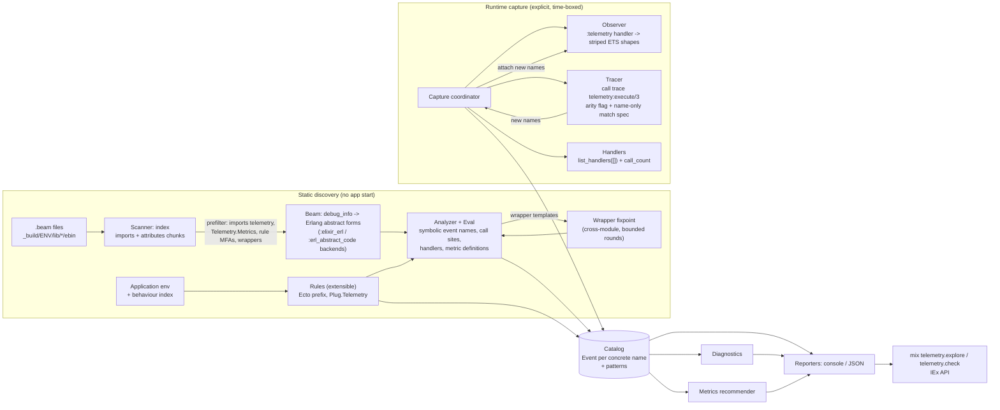

# TeleScope architecture

This document describes the components as implemented in the spike, the data
model, the merge semantics of the catalog, and the decisions taken (with the
alternatives that were rejected and why). Evidence for every claim is in
[SPIKE_RESULTS.md](SPIKE_RESULTS.md) and [BENCHMARKS.md](BENCHMARKS.md).

## 1. Overview



The core has no Phoenix dependency; the only runtime dependency is
`:telemetry`. Phoenix/Ecto knowledge lives in rules.

## 2. Discovery sequence

```mermaid
sequenceDiagram
  autonumber
  actor Dev as Developer
  participant Mix as mix telemetry.explore --runtime
  participant Scan as Scanner/Analyzer
  participant Cat as Catalog
  participant Cap as Capture
  participant Obs as Observer
  participant Tr as Tracer
  participant VM as BEAM VM (telemetry)
  participant App as Application

  Dev->>Mix: run
  Mix->>Scan: compile, app.config, scan(_build/*/ebin)
  Scan->>Scan: index imports chunks (all beams)
  Scan->>Scan: decode + analyze candidates (parallel)
  Scan->>Scan: wrapper fixpoint across modules
  Scan->>Cat: call sites, patterns, handlers, metrics
  Mix->>Cat: rule config events (Ecto repos, ...)
  Mix->>Cap: start_capture(literal names, duration)
  Cap->>Obs: attach_many(literal names)
  Cap->>Tr: start(known = literal names)
  Tr->>VM: session/trace flags [call, arity] on all processes
  Tr->>VM: trace_pattern(execute/3, execute_lazy/3, ms(not is_map_key known), [local])
  Mix->>App: app.start (startup events are captured)
  App->>VM: :telemetry.execute(name, m, md)
  VM->>Obs: handler (emitting process): shape -> ETS stripe
  VM-->>Tr: {trace, Pid, call, {telemetry,execute,3}, Name} (only for unknown names)
  Tr->>Tr: record name; debounce; re-install ms with Name suppressed
  Tr->>Cap: {:new_names, [Name]}
  Cap->>Obs: attach(Name)
  Note over Cap: time box expires (or stop_capture)
  Cap->>Tr: stop -> destroy session / remove patterns, drain
  Cap->>VM: list_handlers([]) + call_count per handler fun
  Cap->>Obs: stop -> detach, snapshot (shapes, counts)
  Cap->>Cat: add_capture(result)
  Mix->>Dev: report (events, patterns, diagnostics, metric suggestions)
```

## 3. Components

### 3.1 Static discovery (`TeleScope.Discovery.*`)

| Module | Responsibility |
|---|---|
| `Beam` | Read chunks safely. `forms/1`: `debug_info_v1` backend -> `:erlang_v1` forms, falling back to the legacy `abstract_code` chunk. Classifies `:no_debug_info` (stripped, Erlang `{none, Opts}`) vs `:invalid_beam` (garbage, truncated - checked with `beam_lib:all_chunks/1`). Never raises. |
| `Scanner` | Orchestrates: index all beams (`imports` + `attributes`), prefilter, decode candidates in parallel (`Task.async_stream`, one module's forms per task), run the wrapper fixpoint, collect `telemetry_event` declarations and the behaviour index. Isolates analysis failures per module. |
| `Eval` | Bounded symbolic evaluator. Produces `TeleScope.EventName` patterns: literals, cons/`++`/`lists:append`, variables bound anywhere in the clause, `case`/`if` unions (<= 16 alternatives), parameters as `{:param, i}`, local helper calls (depth <= 4). |
| `Analyzer` | Walks one module's forms. Detects `telemetry:execute/2,3`, `execute_lazy/2,3`, `span/3`, `attach/4`, `attach_many/4`, `detach/1`, `Telemetry.Metrics.*/1,2`, rule-watched calls, and calls to wrapper functions (templates). Iterates locally to a fixpoint (default-argument chains). |
| `Rule` + `Rules.*` | Behaviour with two optional hooks: `watched_calls/0`+`on_call/3` (static, receives abstract args and evaluators) and `config_events/1` (application env + behaviour index). Failures are isolated. |
| `CallSite` | Location + kind + patterns + `via` (`:direct`, `{:wrapper, mfa, line}`, `{:rule, rule}`). |

**Symbolic event names** (`TeleScope.EventName`): a pattern is a list of parts:
`atom` (known), `{:var, origin}` (one unknown segment), `{:splice, origin}`
(zero or more). `origin` is `:unknown` or `{:param, i}`. Classification:
`:literal`, `:partial`, `:dynamic`, `:invalid`. Patterns match concrete names
(`EventName.matches?/2`), which links runtime discoveries back to call sites.

**Wrapper resolution.** A telemetry call whose pattern references a parameter
is a *template* of its function. Calls to that function (local or remote) are
resolved by substituting the caller's argument expressions. If the result still
references the caller's parameters, the caller becomes a template too. Within a
module this iterates to a fixpoint; across modules the scanner re-analyzes
modules whose `imports` contain a template MFA (bounded: 4 global rounds; the
spike converged in 2). Templates themselves are reported as partial patterns
flagged `wrapper_template` and are never used as evidence for other names.

### 3.2 Runtime (`TeleScope.Runtime.*`)

| Module | Responsibility |
|---|---|
| `Tracer` | (Updated in the pre-release audit: suppression is installed by a short-lived installer process; a trace-control-word gate bit in the match spec stops unknown-name messages within ~2 us under mailbox pressure; the message path is preloaded at start; one legacy tracer at a time.) Event-name discovery via call tracing. Backends: `:session` (OTP 27+, isolated `trace:session_create/3`, owned by the tracer process -> destroyed with it) and `:legacy` (OTP 26, `erlang:trace/3`, janitor removes patterns). `arity` flag + `{message, '$1'}` match spec => 14-16 word messages regardless of payload. Adaptive suppression via `not is_map_key('$1', {const, Known})` (O(1)), debounced re-install. Limits: duration, mailbox circuit breaker, messages, names. |
| `Observer` | `:telemetry` handler (external capture, config = small key into `:persistent_term`). Hot path: stop-flag read, `:counters` add, optional sampling, `Shape.of_unsorted`, one `ets:update_counter` on a per-scheduler stripe. Slow path once per (shape, scheduler). Janitor detaches handlers and erases the config on `:kill`. Records `[:telemetry, :handler, :failure]`. |
| `Shape` | key -> type tags. Structs keep only their module. Non-atom keys collapsed. Depth 1. Bounded by `max_keys`. |
| `Handlers` | `list_handlers([])` normalisation (config type only), `call_count` invocation tracking (session-isolated on OTP 27+; janitor on OTP 26), shared-function detection. |
| `Capture` | Coordinates observer + tracer + handler tracking for one time box; refreshes handler tracking every 250 ms (handlers attached after start); tolerates a crashed tracer. |

### 3.3 Catalog, diagnostics, metrics, reporters

* `TeleScope.Catalog` - see the data model below.
* `TeleScope.Diagnostics` - a registry of definitions with stable codes
  (`TS001`-`TS013`, see [DIAGNOSTICS.md](DIAGNOSTICS.md)) and one pure
  function per check. Every diagnostic carries code, severity, title,
  message, suggestion, locations and check-specific detail; `limitation:
  true` marks coverage notes (`no_debug_info` for dependencies,
  `capture_limited`, `scan_error`), which are always `:info`.
  `evaluate/2` turns diagnostics into a pass/fail verdict (`--strict` adds
  warnings; limitations never fail). Output is sorted deterministically,
  and the scanner keeps task results ordered so repeated scans produce
  identical reports.
* `TeleScope.Metrics` - see section 6.
* Reporters - console text and JSON (schema version 1, own encoder: Elixir's
  `JSON` only exists from 1.18).

## 4. Data model

```
%TeleScope.Event{
  name:            [atom]                     # concrete name (catalog key)
  span:            %{prefix, role} | nil      # role in :start | :stop | :exception
  apps:            MapSet(atom)               # apps with call sites / rules
  sources:         MapSet(evidence)           # see below
  call_sites:      [CallSite]                 # emitting sites (deduplicated)
  rule_reasons:    [%{rule, reason, emitted_by}]
  declaration:     map | nil                  # telemetry_registry declaration
  observed:        true | false | nil         # nil = no capture covered it
  count, count_estimated, first_seen_at, last_seen_at
  measurements:    %{key => %{types: %{type => n}, seen, presence}}
  metadata:        same
  shape_count, processes, trace
  handlers:        [%{id, function, config_type, invocations, invocations_shared_with, invocations_attributable}]
  static_handlers: [%{id, function, location, module}]
  metrics:         [%{metric_type, metric_name, measurement, unit, tags, location}]
}

%TeleScope.Catalog{
  events:   %{[atom] => Event}
  patterns: %{pattern => %{pattern, classification, call_sites, matched, wrapper_template, wrapper_resolved}}
  static:   %{stats, no_debug_info, errors}
  runtime:  %{started_at, finished_at, duration_ms, trace, trace_error, observer, handler_failures} | nil
  config_errors: [...]
}
```

**Evidence sources.** Emitter evidence: `:static_literal`, `:static_resolved`,
`:config_rule`, `:declared`, `:runtime_trace`, `:runtime_observed`. Consumer
evidence: `:handler_registration`, `:runtime_handler`, `:metric_definition`.

**Confidence** (strongest first): `:observed` > `:literal` > `:resolved` >
`:configured` > `:declared` > `:referenced`.

**Status**: `:observed` (fired in a capture) / `:not_observed` (the observer
was attached during a capture and it did not fire *in that window*) /
`:static_only` (no capture covered it) / `:referenced_only` (only consumers
mention it). There is deliberately no "does not exist" status.

### Update semantics

1. Every mechanism upserts into the same `Event` keyed by concrete name, so an
   event found statically, by a rule, by the tracer and by the observer is one
   entry with four sources (no duplicates).
2. Sets (`sources`, `apps`) are unions; call sites are deduplicated by
   `{kind, module, function, line, patterns, via, handler}`; re-adding the same
   scan is idempotent (tested).
3. Non-literal emitting sites become `patterns` (aggregated by pattern shape).
   After every merge, patterns are linked to emitted names they match; fully
   dynamic patterns (`[**]`) are linked only through explicit rule evidence
   (`emitted_by`), since they match everything.
4. Runtime data replaces previous runtime data for an event: a capture is a
   window, not history. The observer's count is reconciled with the tracer's
   lower bound for names discovered mid-capture (`count_estimated: true`).
5. `span/3` sites expand to `prefix ++ [:start | :stop | :exception]`; every
   name ending in those suffixes is grouped by prefix (`Catalog.spans/1`).

## 5. Configuration-aware discovery (rules)

Rules are plain modules implementing `TeleScope.Discovery.Rule`:

```elixir
@callback watched_calls() :: [mfa()]                       # static call-site hook
@callback on_call(mfa(), [abstract_expr], ctx) :: [{kind, [pattern], extra}]
@callback config_events(%{apps, get_env, implementations}) :: [%{name, kind, reason, ...}]
```

* `Rules.Ecto` - repos from `config :app, ecto_repos:` **and** modules with
  `@behaviour Ecto.Repo` in the scanned beams; prefix from repo config
  `:telemetry_prefix` or Ecto's own default derivation (`Module.split |>
  Macro.underscore`), event `prefix ++ [:query]`; links to the dynamic call
  site in `Ecto.Adapters.SQL` via `emitted_by`.
* `Rules.PlugTelemetry` - both compiled shapes of `plug Plug.Telemetry,
  event_prefix: p`: `Plug.Telemetry.init([event_prefix: p])` (runtime init
  mode, Phoenix dev/test) and `Plug.Telemetry.call(conn, {start, stop, opts})`
  (compile init mode). `event_prefix` is evaluated symbolically, so a
  non-literal prefix degrades to a partial pattern.

Users and libraries add rules with `TeleScope.scan(rules: [...])`. A failing
rule is reported in `catalog.config_errors` and never breaks discovery.

## 6. Metrics recommendation engine

* Span `:start` -> nothing; span `:stop` -> `summary(... .duration, unit:
  {:native, :millisecond})`; span `:exception` -> `counter`.
* Standalone events: durations (`duration`, `*_time` except timestamps such
  as `system_time`/`monotonic_time`, `*_duration`) -> summary in native units
  (flagged "verify"); gauges (`total`, `*_size`, `*_count`, ...) ->
  `last_value`; otherwise `counter`.
* Tags: only metadata keys present on 100 % of observed events with atom,
  module or boolean types; others are returned as `rejected_tags` with their
  types (possible high cardinality).
* Already-defined metrics (found statically) are skipped.
* With runtime data, only event groups that fired are considered.
* Every suggestion has `reason` and `confidence` (`:high` observed, `:medium`
  `:telemetry.span/3` contract, `:low` naming heuristic); `to_code/1` emits a
  review banner.

## 7. Decisions and rejected alternatives

| Decision | Rejected alternative | Why |
|---|---|---|
| Analyse **Erlang abstract forms** from debug info | Parse Elixir source; use `elixir_v1` debug info | One walker for Elixir and Erlang; macros already expanded (Plug.Router/`use` generated calls appear in the user module); works for deps without sources. |
| **Prefilter by `imports` chunk** | Decode every module | 48 of 840 modules decoded; imports are present even without debug info. |
| Bounded **symbolic evaluation** + **wrapper templates** | Literal-only extraction | Literal-only finds 60 of 126 literal name sites; wrappers resolve 65 more (Finch, Oban, Bandit, ThousandIsland, app wrappers). |
| Rules as an **extension point** | Hardcode Ecto/Phoenix | Config- and option-derived names are library knowledge; rules are isolated and pluggable. |
| Tracer with **`arity` flag + name-only match spec** | Default call trace | Without `arity`, every message copies all arguments (2,044 words for 10 KB metadata vs 14). |
| **`local`** trace patterns | `global` | `span/3` and `execute/2` reach `execute/3` via local calls; `global` misses span events. |
| **`is_map_key` constant-map suppression** | One `{message,false}` clause per known name | Clause lists cost O(n): 200 clauses -> 2.4-4.8 us/call. Map guard: flat 0.6-0.9 us from 1 to 10,000 names. |
| **Trace sessions** on OTP 27+, legacy fallback | Legacy only | Legacy: one tracer per process (dbg/recon users silently lose processes), global patterns, stale breakpoints after tracer death. Sessions are isolated and die with their owner. |
| Tracer needed at all | Wildcard handler | `:telemetry` has no wildcard attach; unknown names can only be discovered by tracing. |
| **Per-scheduler striped ETS rows** | One row per shape | One row: 103,670 ns/event with 12 concurrent emitters (lock convoy). Striped: 907 ns (ratio to baseline equals single-process ratio). |
| **`:counters` + read-only stop flag, soft cap** | `:atomics.add_get` hard cap | Global counter is a contended cache line on every event. |
| Handler config = **small key into `:persistent_term`** | Config map with ETS/counters refs | :telemetry copies the handler record from ETS on every execute; magic refs cost refcount traffic: +184 ns vs +56 ns with 12 emitters. Cost: one global literal-area scan when erased (once per observer). |
| **Unsorted shape fold** on hot path | Sorted iterator | 30-key map: 2.3 us -> 0.56 us. Deterministic order for equal key sets. |
| `process_info(Pid, {dictionary, '$initial_call'})` | `proc_lib:translate_initial_call/1` | The latter copies the whole dictionary of another process (privacy). |
| **Async installer + TCW gate** (audit) | Synchronous re-install / debounce only | `trace_pattern` re-install takes 53-166 ms under load; a hot new name queued 128k-240k messages meanwhile. Gate close: ~2 us. |
| **Preload the tracer's message path** (audit) | Lazy loading | First burst in a fresh VM: 7k-87k queued messages vs 12 after preloading. |
| **Allowlisted debug-info backends** (audit) | Call the backend named in the file | The backend module is chosen by the (untrusted) `.beam` file. |
| Severity by **consumer ownership** (validation) | Severity by pattern evidence only | Plausible: a never-firing project handler was hidden by `[**, :exception]`; making such patterns non-evidence alone would flag Sentry's optional Quantum handlers in every app. |
| Rules declare **optional measurements** (validation) | Warn on every missing measurement | Ecto's `idle_time` is absent under a SQL sandbox; a correct metric looked broken. |
| `telemetry_registry` declarations as an **extra source** | Primary mechanism | None of the 36 apps in the spike declare events; it requires adoption. |
| `TeleScope` namespace | `TelemetryExplorer` (as suggested) | Matches the product name; the suggested structure is otherwise followed with adjustments (single `diagnostics.ex`, `catalog.ex`, `event_name.ex`, `rules/`). |
| No LiveDashboard yet | Build UI | Discovery engine first (as instructed); the JSON report is the integration surface. |
